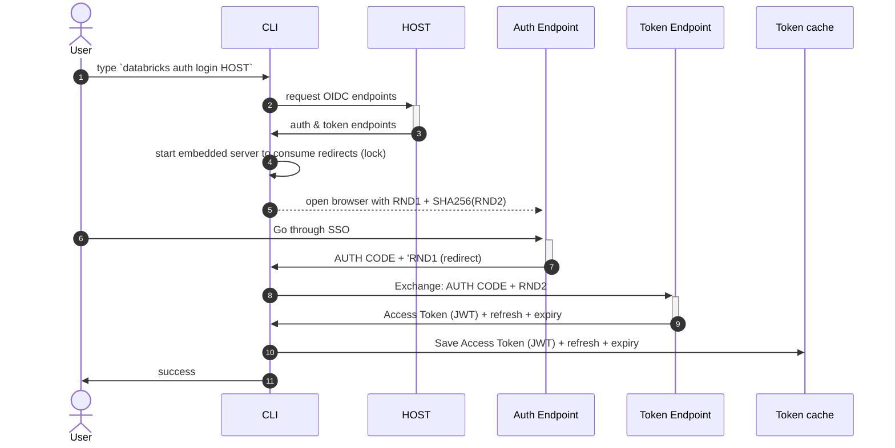
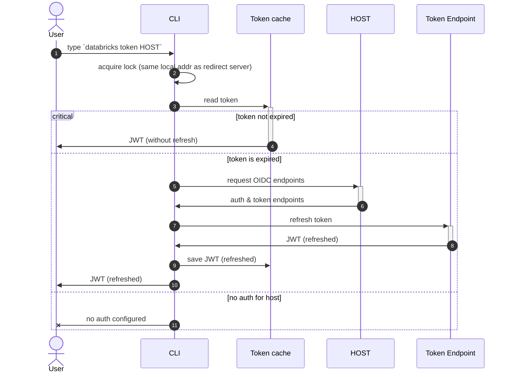
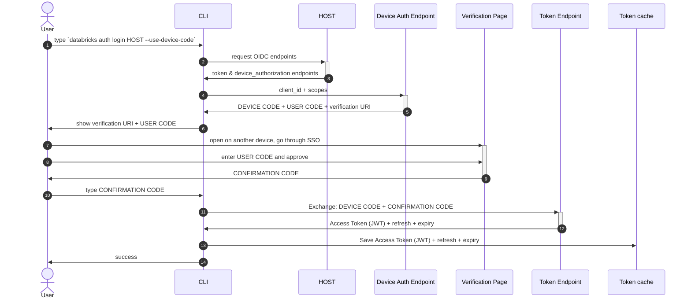

# Auth challenge (happy path)

Simplified description of [PKCE](https://oauth.net/2/pkce/) implementation:

# Token refresh (happy path)

# Device code login (experimental)

`databricks auth login --use-device-code` logs in from a machine without a browser.
It is experimental: the flag is hidden and requires
`DATABRICKS_CLI_DEVICE_CODE=true`. Only workspace hosts are supported. See
[docs/device-code-login.md](../../docs/device-code-login.md) for the user guide.

Databricks implements a variant of [RFC 8628](https://datatracker.ietf.org/doc/html/rfc8628):
instead of polling the token endpoint until the user approves the login, the
browser shows the user a confirmation code, which the CLI sends together with
the device code in a single token request.

Notes on the server behavior the CLI relies on:

- Workspaces advertise `device_authorization_endpoint` in
  `/oidc/.well-known/oauth-authorization-server` only when device code login
  is enabled for them. The CLI fails before requesting a device code if it is
  missing.
- The token request carries the confirmation code in the `confirmation_code`
  form parameter. A wrong confirmation code does not consume the device code;
  a successful exchange does. The server answers a wrong confirmation code
  with HTTP 400 and `invalid_request`, and the CLI lets the user enter it up
  to 3 times in total. Any other error ends the login, including an unknown
  device code, which the server answers the same way but with the
  description `Invalid device code`.
- Approving the login in the browser extends the device code's lifetime, so
  the CLI does not enforce the `expires_in` from the device authorization
  response.
- The refresh token is single-use (rotating) and has an absolute lifetime of
  24 hours by default. After that, `databricks auth token` fails with a
  refresh error and the user needs to log in again.

## Non-interactive login

Device code login reads the confirmation code from stdin. When stdin is not a
terminal (`cmdio.IsInputTTY`), for example when an AI agent runs one-off shell
commands, nobody can type the code in, and `auth login --use-device-code` runs
in two steps instead:

1. `auth login --use-device-code` requests the device authorization, stores
   the device code as a pending login in the token store, and prints the
   verification URI and the user code. It skips the prompts and saves no
   profile.
2. The same command with the hidden `--user-code` and `--confirmation-code`
   flags exchanges the pending device code instead of requesting a new one,
   and the rest of the login runs as usual.

The pending login is kept in the token store (`storage.PendingLoginStore`) under
the login's cache key (the profile name, or the host without a profile), but
apart from the tokens: in the `pending_logins` map of the token cache file, or
under the `databricks-cli-pending-login` keyring service. A pending login can
therefore neither replace a token nor be read as one, whatever a profile is
named, and the target's current token keeps working until the login completes.
The device code never leaves the machine;
only the user code and the confirmation code are printed or passed on the
command line, and the confirmation code is useless without the device code.
This keeps the confirmation code's protection against phishing: a code read
from, e.g., an agent's transcript cannot complete the login on another machine.

Each target has one pending login, and a new login for it replaces the old
one. The second step checks the user code, so a replaced login fails with a
clear error without sending its confirmation code. A wrong confirmation code
keeps the pending login for a rerun. A device code the server no longer knows
deletes it, and so does any successful login for the same target
(`storeLoginToken`), with or without device code. The CLI does not expire
pending logins itself: the server does. `auth logout` deletes the pending login
of the profile, and the one of its host when it deletes the host's token. A
pending login for a profile that was never saved, or for a host that no profile
uses, stays until a new login for it replaces it.
