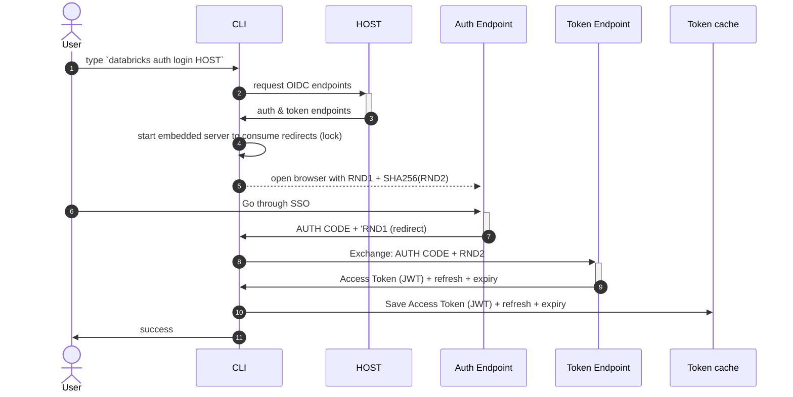
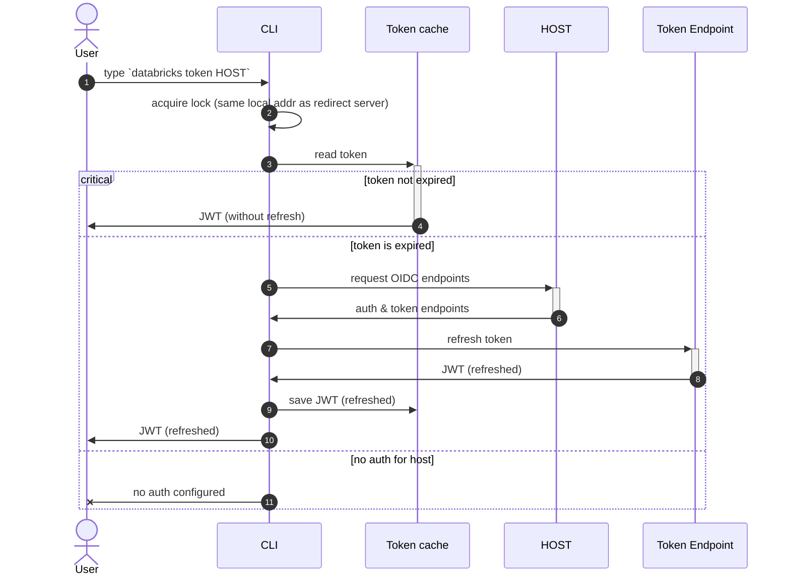
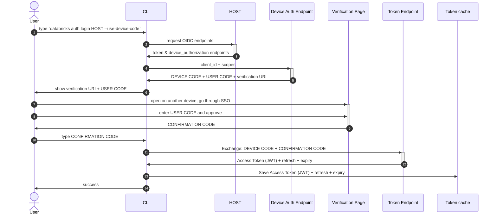

# Auth challenge (happy path)

Simplified description of [PKCE](https://oauth.net/2/pkce/) implementation:

# Token refresh (happy path)

# Device code login (experimental)

`databricks auth login --use-device-code` logs in from a machine without a browser.
It is a proof of concept: the flag is hidden and requires
`DATABRICKS_CLI_DEVICE_CODE=true`. Only workspace hosts are supported. See
[docs/device-code-login.md](../../docs/device-code-login.md) for the user guide.

Databricks implements a variant of [RFC 8628](https://datatracker.ietf.org/doc/html/rfc8628):
instead of polling the token endpoint until the user approves the login, the
browser shows the user a confirmation code, which the CLI sends together with
the device code in a single token request.

Notes on the server behavior the CLI relies on:

- Workspaces advertise `device_authorization_endpoint` in
  `/oidc/.well-known/oauth-authorization-server` only when device code login
  is enabled for them. The CLI fails early if it is missing.
- The token request carries the confirmation code in the `confirmation_code`
  form parameter. A wrong confirmation code does not consume the device code;
  a successful exchange does. The server answers a wrong confirmation code
  with `invalid_request`, and the CLI lets the user enter it up to 3 times in
  total.
- Approving the login in the browser extends the device code's lifetime, so
  the CLI does not enforce the `expires_in` from the device authorization
  response.
- The refresh token is single-use (rotating) and has an absolute lifetime of
  24 hours by default. After that, `databricks auth token` fails with a
  refresh error and the user needs to log in again.
